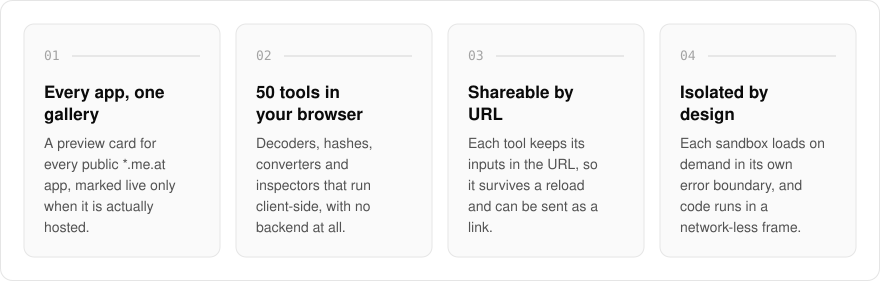
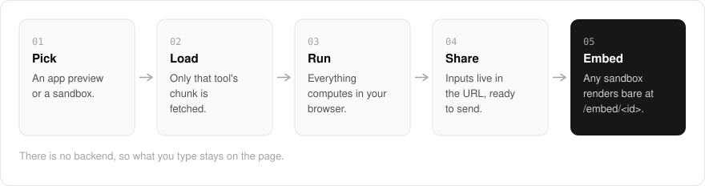

  <picture>
    <source media="(prefers-color-scheme: dark)" srcset=".github/assets/hero-dark.png">
    
  </picture>

<h1 align="center">try.me.at</h1>

<strong>Browse every `*.me.at` app, then decode, hash, convert and format right in your browser, with nothing to install.</strong>

  
  
  

  <a href="https://try.me.at">Website</a> ·
  <a href="#features">Features</a> ·
  <a href="#how-it-works">How it works</a> ·
  <a href="#built-with">Built with</a>

Most quick online tools mean pasting your data into a site you know nothing about. I built try.me.at as the demo gallery and sandbox playground of my `*.me.at` family: a preview card for every public app next to a shelf of 50 small, fully client-side tools, so you can click through things instead of reading about them. Everything runs in your browser with no backend, and what you type stays on the page.

  <picture>
    <source media="(prefers-color-scheme: dark)" srcset=".github/assets/overview-dark.svg">
    
  </picture>

## Why try.me.at

| The usual online dev tool | try.me.at |
| --- | --- |
| May send what you paste to a server | No backend: what you type stays on the page |
| One tool per site | 50 sandboxes in one place |
| Input lost on reload | Inputs kept in the URL, shareable as a link |
| One broken widget takes down the page | Each sandbox runs inside its own error boundary |

## Features

- **App showroom**: one preview card per public `*.me.at` app, filterable by sites, content and tools, and marked "Live now" only for apps that are actually hosted.
- **50 in-browser sandboxes**: regex tester, JSON inspector, contrast checker, hash and checksum digests (CRC, Adler, Fletcher), hex, Base32, Base58, Base64, Ascii85 and Z85 codecs, JWT, URL and ID inspectors (UUID, ULID, Snowflake, KSUID, NanoID and more), cron explainer, color converter, Markdown preview, line diff, IPv4/IPv6 CIDR and more.
- **Code playground**: write JavaScript or JSX and run it in an isolated, network-less frame with console output.
- **Shareable state**: each tool keeps its inputs in the URL, so a filled-in tool survives a reload and can be sent as a link.
- **Isolated demos**: every sandbox is a lazily loaded chunk inside its own error boundary, so one crashing never takes down another.
- **Embeddable**: any sandbox can be rendered without site chrome at `/embed/<id>` for framing in other family pages.
- **Project shelf**: finished projects with public live demos, each opening on its own host.

## How it works

  <picture>
    <source media="(prefers-color-scheme: dark)" srcset=".github/assets/flow-dark.svg">
    
  </picture>

Pick an app preview or a sandbox and only that tool's chunk loads, inside its own error boundary so one crash cannot take down another. Everything computes in your browser, and each tool keeps its inputs in the URL, so a filled-in tool survives a reload and can be sent as a link. Any sandbox can also render without site chrome at `/embed/<id>` for framing in other family pages.

## Built with

  
  
  
  
  
  

- Next.js 16 (App Router), React 19, TypeScript
- Tailwind CSS 4
- nuqs for URL-backed tool state
- Vitest and Playwright

## Part of the me.at family

try.me.at is one of my [`*.me.at`](https://me.at) apps. They share one design system, account, and app shell. Development happens in a private monorepo; this repository is the project's public-facing home.

## License

Source-available. See [LICENSE](LICENSE).
