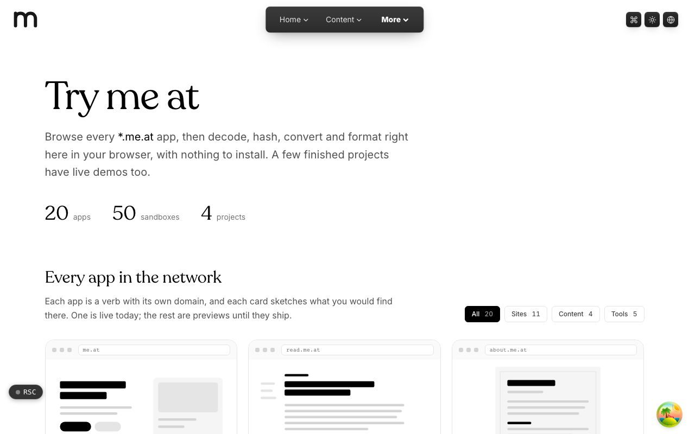

  <picture>
    <source media="(prefers-color-scheme: dark)" srcset=".github/assets/hero-dark.png">
    
  </picture>

# try.me.at

Browse every `*.me.at` app, then decode, hash, convert and format right in your browser, with nothing to install.

try.me.at is the demo gallery and sandbox playground of the `*.me.at` family. It puts a preview card for every public app in the network next to a shelf of small, fully client-side tools, so you can click through things instead of reading about them. Everything runs in the browser with no backend, and what you type stays on the page.

**Live:** [try.me.at](https://try.me.at)

## Features

- **App showroom**: one preview card per public `*.me.at` app, filterable by sites, content and tools, and marked "Live now" only for apps that are actually hosted.
- **50 in-browser sandboxes**: regex tester, JSON inspector, contrast checker, hash and checksum digests (CRC, Adler, Fletcher), hex, Base32, Base58, Base64, Ascii85 and Z85 codecs, JWT, URL and ID inspectors (UUID, ULID, Snowflake, KSUID, NanoID and more), cron explainer, color converter, Markdown preview, line diff, IPv4/IPv6 CIDR and more.
- **Code playground**: write JavaScript or JSX and run it in an isolated, network-less frame with console output.
- **Shareable state**: each tool keeps its inputs in the URL, so a filled-in tool survives a reload and can be sent as a link.
- **Isolated demos**: every sandbox is a lazily loaded chunk inside its own error boundary, so one crashing never takes down another.
- **Embeddable**: any sandbox can be rendered without site chrome at `/embed/<id>` for framing in other family pages.
- **Project shelf**: finished projects with public live demos, each opening on its own host.

## Built with

- Next.js 16 (App Router), React 19, TypeScript
- Tailwind CSS 4
- nuqs for URL-backed tool state
- Vitest and Playwright

## Part of the me.at family

try.me.at is one of my [`*.me.at`](https://me.at) apps. They share one design system, account, and app shell. Development happens in a private monorepo; this repository is the project's public-facing home.

## License

See [LICENSE](LICENSE).
